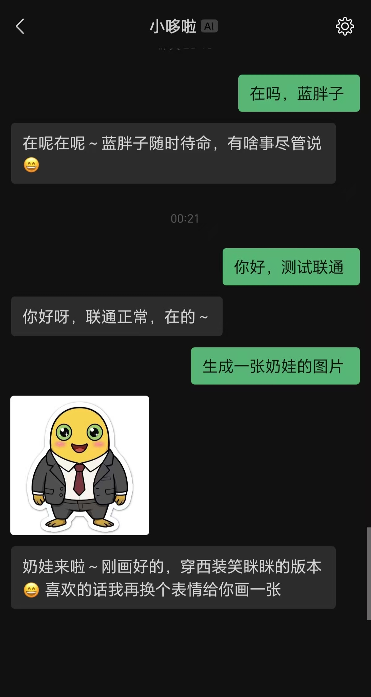
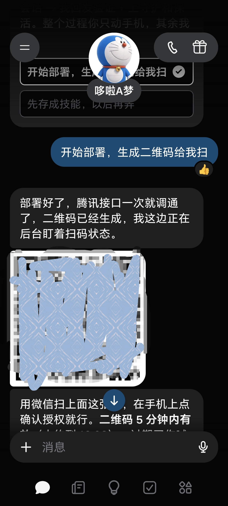

# muse-wechat-bot: Move Muse Into Your WeChat

[中文](README.md) | **English**

A single self-contained "skill file" that connects your own Muse to WeChat
through Tencent's official iLink Bot API. After a one-time QR-code binding,
the Muse you talk to in WeChat is your Muse itself — same long-term memory,
same tools and skills, not a stranger bot. Away from your desk, phone in hand,
you can keep talking to it in WeChat, hand it tasks, and get results back.

> This repository is **v2**, revised and hardened from the original skill
> publicly shared by X user
> [@yedabinbinah](https://x.com/yedabinbinah/status/2109472249095008636)
> (original file: https://szb123.com/files/muse-wechat-bot-skill.md ).
> See [What v2 changed](#what-v2-changed) for the differences and
> [Credits & sources](#credits--sources) for full attribution.

<p align="center">
  
</p>
<p align="center"><em>Live after deployment: everyday chat, a connectivity test, and asking it to generate an image delivered straight into WeChat</em></p>

---

## What it can do

Once bound, right inside WeChat you can:

- **Chat** — exactly like in Muse's main chat. It remembers your long-term
  memory, goals and preferences, and the two sides stay in sync: tell it
  something in WeChat and it knows it in the main chat too.
- **Delegate tasks** — look things up, read links, set reminders, refresh
  your spaces, organize information. It has hands: tasks given in WeChat get
  done in the background and reported back in WeChat.
- **Exchange images, video and files** — ask it to generate an image or a
  video, or to send you a file, and it lands directly in the WeChat
  conversation; media you send it is received and processed as well.
- **Send voice messages** — WeChat voice is transcribed to text for it (when
  no transcript exists, it says so and asks you to type — it never pretends
  it heard you).
- **Send it links to read** — forward an article link and it reads the
  original and summarizes it. If the original genuinely can't be fetched, it
  tells you honestly and hands off to the main chat's real browser — it never
  passes off a search-assembled summary as the original text.
- **Let it reach out (under your control)** — for urgent, time-sensitive
  matters it can message you first, without waiting for you to write. The
  scope is yours to set at deployment: urgent-only, or everyday gentle
  reminders and tips too.
- **(Optional) A nightly WeChat digest** — each evening, the day's WeChat
  conversation is summarized into a one-page digest for easy review; the
  skill file includes the implementation notes.

## What it is not (expectations first)

- **Not a group bot.** It serves only the person who scanned the QR code and
  only handles that person's private chats. Group chats and strangers are
  ignored — a hard-coded whitelist; loosening it requires your explicit call.
- **Not a protocol hack.** It uses Tencent's officially published iLink Bot
  API — the same official protocol the WeChat ClawBot plugin uses (docs in
  Tencent's official repo
  [Tencent/openclaw-weixin](https://github.com/Tencent/openclaw-weixin)).
  No reverse engineering, no hooking, no simulated logins, so account risk
  is far lower than grey-market approaches — but please still read the
  disclaimer below.
- **Not instant.** Receiving is real-time, but waking Muse and generating a
  reply takes ~30–60 seconds in testing — a "they're typing…" feel, not
  instant-messaging speed.
- **Not a confirmation clicker.** Steps that need your tap in an app —
  payments, sending to third parties, QR logins to other services — cannot
  be done from WeChat; it will route you back to the main chat for those.

## How it works (the 30-second version)

```
Your WeChat ⇄ Tencent's official iLink API ⇄ bridge.py (a small Python bridge, resident daemon)
                                              ⇄ local queue (SQLite)
                                              ⇄ event hook: peeks at the local queue every 5 s
                                                 — nothing new: nothing happens (zero cost)
                                                 — something new: Muse itself is woken to handle it
                                              ⇄ Muse replies / does the task → sent back via the bridge
```

Three design decisions are the soul of this v2:

1. **Zero idle cost.** The old approach woke the AI every minute to ask "any
   news?", burning quota even in silence. Here a local script polls a local
   queue; idle time wakes nothing and costs nothing — money is spent only on
   real replies. Maintainer's measurement: a full day of heavy use (a
   dozen-plus WeChat exchanges plus heavy main-chat work) added roughly 1%
   of a weekly Muse quota; idle is 0. (Your actual usage depends on your
   plan; treat this as a reference point.)
2. **Atomic claiming.** A message being handled is claimed and locked, so it
   can never be answered twice; if the handler dies mid-flight, the claim
   expires after 10 minutes and the message is re-queued — never lost.
3. **An honesty red line.** The wake prompt hard-codes rules earned the hard
   way: verify before explaining a cause, never invent one; a pre-existing
   image/video must be labeled as such, never passed off as freshly made;
   factual questions are verified by web search before answering.

## Quick start (really just three steps)

**Prerequisites**: a working Muse; an always-on machine (Muse's own cloud
runtime works, your own VPS is better); a WeChat version that supports the
ClawBot plugin (the iLink Bot channel was opened by Tencent in March 2026).

1. **Get the skill file.** Download
   [`muse-wechat-bot-v2.en.md`](muse-wechat-bot-v2.en.md) from this repo
   (Chinese version: [`muse-wechat-bot-v2.md`](muse-wechat-bot-v2.md)),
   or just send the file's link to your Muse.
2. **Say one sentence to Muse**: "Set me up on WeChat following this file."
   Environment checks, deployment, the daemon, the hook — it does all of it.
3. **You do exactly two things**: ① when it sends you a QR code, scan it with
   WeChat and confirm on your phone (the code is valid for 5 minutes;
   occasionally there's an extra numeric pairing code — just give Muse the
   digits shown in WeChat); ② after binding, **send it a first message in
   WeChat** (e.g. "hello") — an iron rule of the official API: with no
   session, every send is rejected. When it replies, you're fully live.

Start to finish is about 10 minutes when it goes smoothly, with under a
minute of your own hands-on time.

<p align="center">
  
</p>
<p align="center"><em>Deployment, live: say "start deploying" and Muse sends the QR code right into the chat — scan and confirm to bind (the QR code is scribbled out in this screenshot)</em></p>

## Deployment in detail (for those who want to see the moving parts)

Every step below is performed by Muse automatically; this table exists so
you know what to expect and what to check.

| Step | What happens | What you do |
| --- | --- | --- |
| 0. Machine | Confirm which always-on machine hosts the bridge (VPS best, Muse's cloud runtime next, your own computer last) | Nothing |
| 1. Environment | Check Python 3.8+; install `requests`, `qrcode`, `pycryptodome`; test API connectivity | Nothing |
| 2. Deploy the bridge | The skill file's appendix source is written verbatim to `~/wechat-bot/bridge.py` and syntax-checked | Nothing |
| 3. QR binding | Muse fetches the QR code, renders it locally to an image and sends it to you; polls authorization in the background; on success the token is stored in `~/wechat-bot/auth.json` (mode 600) | **Scan + confirm on your phone** (and report a pairing code if asked) |
| 4. Open the session | Muse asks you to send the first WeChat message; verifies receive + reply | **Send any message in WeChat** |
| 5. Daemon + hook | `launch.sh` starts the daemon (long-polling, media saving, queueing); the 5-second local event hook is registered with the wake prompt | Nothing |
| 6. Acceptance | `bridge.py status` shows the daemon alive; a live round-trip test of text and one image in WeChat | Glance at WeChat to confirm |

**Security note**: the token in `auth.json` is the key to the whole chain —
effectively the password of this WeChat bot identity. The bridge stores it
only on your machine, mode 600. Never send that file to anyone, never commit
it to any repository, never paste it into a chat.

## Using it after deployment

- **Everyday chat**: open the conversation in WeChat and just talk — no
  commands to learn. Tone, memory and abilities match the main chat.
- **Give it tasks**: plain language works — "look up X for me", "read this
  link and summarize it", "remind me tomorrow at 3pm to submit the report".
  It reports back in WeChat when done; anything needing your in-app
  confirmation is routed to the main chat with an explanation.
- **Files both ways**: say "send me that image" or "generate a … and send it
  over" and the file lands in WeChat; forward it images, files or videos
  from WeChat for processing.
- **Proactive scope**: to change what may proactively reach you on WeChat,
  say so in the main chat (e.g. "WeChat only for urgent things" or "gentle
  everyday reminders are fine too") and it records your preference.
- **Turning it off**: ask Muse to stop the daemon and remove the hook and
  all traffic stops. To remove it entirely, also delete `~/wechat-bot/` and
  revoke the authorization in WeChat's ClawBot plugin settings. The binding
  never expires on its own, but a stopped bridge exchanges nothing.

## Ongoing notes (the maintenance checklist)

- **The 24-hour proactive window**: the binding never expires, but
  *proactive sending* relies on a recent session — if you haven't messaged
  the bot in ~24 hours, its proactive sends may be rejected by the server
  (any message from you instantly restores the window). Receiving and
  replying are unaffected.
- **Server pauses (-14)**: Tencent occasionally pauses an account's session
  for an hour. The daemon backs off automatically; leave it alone and never
  let Muse hammer the API.
- **Machine restarts/resets**: the hook checks the daemon on every poll and
  revives it if dead, so cloud resets self-heal. If it's silent for a long
  time, have Muse look at `~/wechat-bot/bridge.log`.
- **Logs and queue grow slowly**: `bridge.log` and `queue.db` hold your
  conversation records — your private data, stored only on your own machine.
  Ask Muse to prune old records periodically if you care.
- **The protocol may change**: iLink is Tencent's official API and may
  evolve; the bridge may need matching updates. Watch
  [Tencent/openclaw-weixin](https://github.com/Tencent/openclaw-weixin);
  the protocol layer lives in the single `bridge.py` file, so updates are
  contained.
- **Never run two pipelines**: the hook approach and a per-minute cron loop
  must not coexist — that's how duplicate replies happen.
- **After big WeChat updates**: plugin availability can shift with major
  WeChat versions; send a test message after updating before relying on it
  for anything important.

## FAQ

- **Why does a reply take half a minute?** Receiving is real-time; the delay
  is waking Muse plus generation — the price of zero idle cost.
- **Can it work in group chats?** No (by default). The whitelist admits only
  your own private chats.
- **New phone / new WeChat account?** Just re-run the QR binding; the bridge
  and its data live on the machine, unaffected.
- **Token leaked?** Revoke the ClawBot authorization in WeChat, delete
  `auth.json`, and re-bind to mint a fresh token.
- **It says "I can't send images"?** You're running the old bridge. v2
  implements image/video/file sending — ask Muse to upgrade `bridge.py`
  following the v2 skill file.

## Repository layout

```
.
├── README.md                    # Chinese README
├── README.en.md                 # This file
├── muse-wechat-bot-v2.md        # Skill file (Chinese): deployment manual + full bridge.py source + prompt templates
├── muse-wechat-bot-v2.en.md     # Skill file (English): same content, code appendices identical
├── IMG_20261114_003623.jpg      # Screenshot: chatting in WeChat after deployment
└── Screenshot_20261114_004955_com_facebook_aura_AuraMainActivity_edit_2345336915878447.jpg
                                 # Screenshot: the QR-scan deployment (QR code scribbled out)
```

The skill file is **single-file and self-contained**: everything your Muse
needs is inside it, no code repository to clone — which is exactly why
"send it to Muse with one sentence" works.

## What v2 changed

v2 was revised by this repository's maintainer after a full day of real
deployment and heavy use, item by item, against the original (all changes
backed by live tests; details in the skill file's own change log):

1. Reply architecture moved from a per-minute wake-up cron to a local event
   hook with zero idle cost, including the hook script and definition
   template;
2. Media **sending** completed (images/video/files via the official upload
   flow) — the original could only send text;
3. Inbound media no longer dropped: videos and files are actually saved,
   every image path is recorded, untranscribed voice is explicitly marked;
4. `inbox-new` became an atomic claim (no duplicate replies) with automatic
   re-queue on timeout (no lost messages); a read-only `inbox-peek` counter
   was added;
5. QR acquisition fixed: the API returns the QR *content* link, which must
   be rendered locally — the original handling produced nothing scannable
   in practice;
6. Dependencies completed (`qrcode`, `pycryptodome` are now required);
7. A wake-prompt template was added: fast casual chat vs. tasks done for
   real, verify-facts-first, the honesty red line, the read-the-original
   link rule, and acks storing the full reply text;
8. The ~24-hour proactive-send window and the failure fallback were
   clarified;
9. Troubleshooting and known limits were completed with measured entries
   (the static-image misunderstanding, duplicate replies, unreleased
   claims, and more).

## Credits & sources

- **Original skill author**: X user
  [@yedabinbinah](https://x.com/yedabinbinah), sharing post:
  https://x.com/yedabinbinah/status/2109472249095008636 , original file:
  https://szb123.com/files/muse-wechat-bot-skill.md . The bridging approach,
  the original `bridge.py` and the deployment manual in this project all
  originate from that file; this repository is a modified edition (v2) built
  on top of it. The original file carried no license statement; its
  copyright remains with the original author. If the original author objects
  to this republication or the modifications, please open a GitHub Issue and
  we will respond promptly.
- **Protocol source**: the iLink Bot protocol documentation published by
  Tencent's official open-source repository
  [Tencent/openclaw-weixin](https://github.com/Tencent/openclaw-weixin).
- **This edition's revisions and maintenance**: by the repository author
  (GitHub: l2890532051-netizen), tested and polished with Muse's
  assistance.

## License notes

- Content **newly added or modified in v2** in this repository (the hook
  architecture, the media send/receive implementation, the prompt templates,
  these READMEs, etc.) is released under the **MIT License**. You are welcome
  to use, modify and re-share it; please keep this section and the credits
  above intact.
- Content **originating from the original file** (the initial bridge code
  and manual framework) remains the original author's and is **not** covered
  by this repository's MIT grant; when using it, respect the original
  author's act of sharing and keep the source links at minimum.

## Disclaimer

- This is an **unofficial community open-source project**. It is **not
  affiliated with, endorsed by, or authorized by** Meta (the maker of
  Muse), Tencent, or WeChat. Product names and trademarks mentioned belong
  to their respective owners and are referenced for descriptive purposes
  only.
- This project uses Tencent's **officially published** iLink Bot protocol.
  It employs no protocol cracking, reverse engineering, injection, or
  security-bypass techniques. Whether any particular usage pattern fully
  complies with the latest WeChat and ClawBot plugin terms is for each user
  to judge and confirm.
- **Use at your own risk.** Any risks arising from using this project —
  including but not limited to features becoming unavailable, account
  restriction or suspension, data loss, or breakage from API changes — are
  borne by the user; the project's author and contributors accept no
  liability for any direct or indirect losses. This disclaimer cannot
  guarantee immunity from any platform rules or applicable laws.
- Message content processed by this project flows through Tencent's official
  API and is stored on your own machine (`queue.db` and similar). Do not use
  it to transmit content you have no right to transmit, and assess your own
  privacy and compliance requirements.
- This project is provided for learning and technical exchange only. Do not
  use it for harassment, spam, fraud, or any unlawful purpose.
